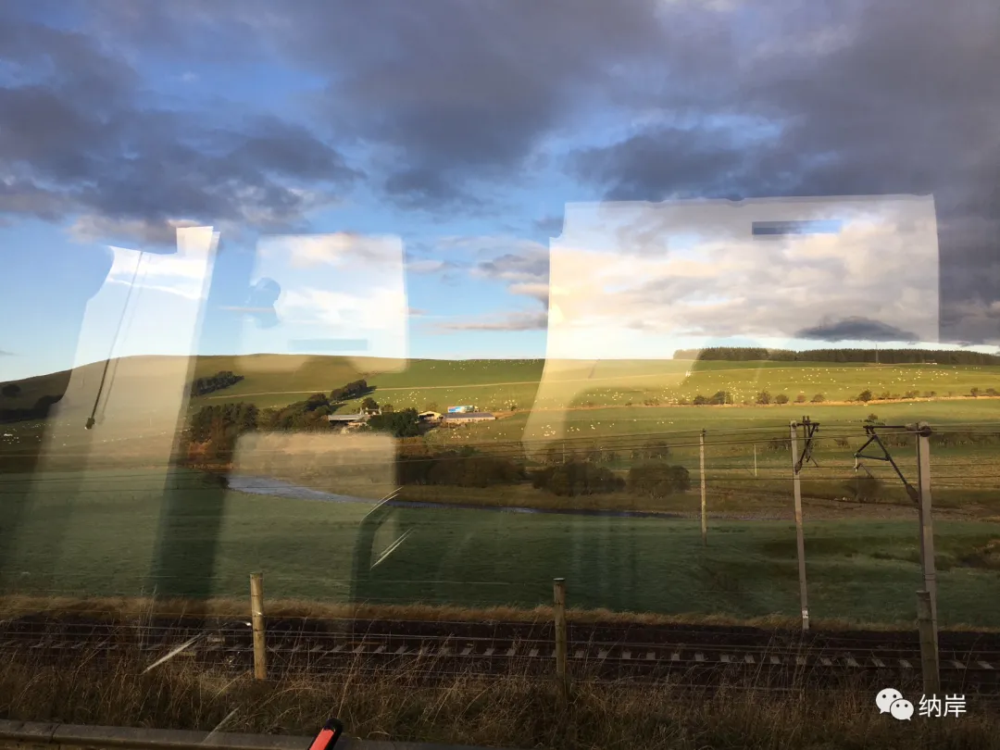

诗，与不像诗的  
或许我们都在  
试着写诗  
语言是意象的游戏  
诗是文字的安房  

## 我希望

我看见金黄的麦田里传来清脆的风笛  
我希望所有伤痛都能被治愈  
我希望所有出现了的都被视为合理  
我希望拿得起的都能被放下  
我希望世间再没有分离  
我希望被践踏过的都能再生生不息  
我希望意识里流动的都能留下痕迹  
我希望正义都能被伸张被认清  
我希望穿梭着的都能成为永恒  
我希望疾呼的心灵都能被感应  
我希望怨恨都能得到和解  
我希望成年人脚下有力量心里有真情  
我希望童年的后院不显得狭小  
我希望睡中的呼吸不显得轰鸣  
我希望有情人能终成眷属  
我希望仇敌能相忘于江湖  
我希望人人举头三尺有神明  
低头心中有悲戚  
我希望爱的以太将你我包围  
我希望在金色领域内如入无人之境  
我希望杀不死的使我更强大  
我希望你的足迹能被找平  
我希望没有妇人之仁和穷困的呻吟  
我希望鼓噪着的都能安息  
我希望所有分离都是逼不得已  
我希望你能将我看清剥离  
我希望玻璃踏空没有暴力  
我希望你能读懂我的渴望  
我希望手能被你牵起  
我希望年迈的人仍能相信  
我希望新鲜的人仍能记忆  
我希望我希望我希望  
所有的愿望都不是不情之请  

2022-04-07 16:51:02

---

*原载于微信公众号「纳岸」，2023年11月23日。*
